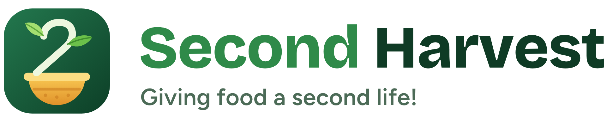

# Second Harvest

**Giving food a second life!**  
Live app: **https://jssoh26.github.io/second-harvest**

Prototype web app for **CC0006 Sustainability (T22 B6)**. Second Harvest connects food businesses, food-waste collectors, black soldier fly (BSF) facilities and the farms that buy back BSF frass fertiliser and feed, in Singapore and Seoul.

## What it does

| Account | Main features |
|---|---|
| 🍜 Food business | Log drop-offs with an animated lid-camera scan for plastics, nearest bins with space, 30-day recycling breakdown, Harvest Shop (swap points for produce from farms in the loop) |
| 🚚 Collector | Smart-bin map (bins appear at 80% full), route planner that fills the van and ends at the BSF facility with room, km/CO₂ saved vs. fixed rounds |
| 🪱 BSF facility | Daily intake quota, accepted waste types, product listings, orders, buyer feedback analytics |
| 🌱 Buyer | Marketplace for frass and BSF feed, 1% back in Harvest points, 10% bulk deal, soil-test matching (Repair), feedback channel |

Switch account (and country 🇸🇬 / 🇰🇷) from the account button. Every account sees a **Live impact** panel: waste diverted to BSF in the last 24 h, what it became (larvae, frass), km saved by routing, and bin-network status.

The **Impact & 9Rs** page maps each feature to Redesign, Reduce, Reuse, Repair, Renew, Recover, Reject, Remanufacture and Recycle, with sub-SDG targets and the NTU → Singapore → ASEAN scale-up.

## Notes

- All facilities, farms, stalls and sensor readings are **sample data**. Bin sensors are simulated; use the sensor simulator on the collector's map.
- Data is stored in each visitor's browser. Reset it from **More → About this prototype**.
- Assumptions: BSF yield 18% fresh larvae and 25% frass per kg of waste; 0.25 kg CO₂e per van-km; road distance = 1.35 × straight line.

## Source

`source/` holds the app source. `node source/gen-seed.js` regenerates the sample data and `node source/build.js` bundles everything into one `index.html` (Preact + htm from unpkg, Google Fonts).

Sources: [NEA food waste statistics](https://www.nea.gov.sg/our-services/waste-management/3r-programmes-and-resources/food-waste-management) · [World Economic Forum on Seoul's RFID bins](https://www.weforum.org/stories/2019/04/south-korea-recycling-food-waste/) · [SMU on Ento Industries](https://news.smu.edu.sg/news/2025/08/27/trash-treasure-how-ento-industries-developed-growing-sustainable-food-waste)
